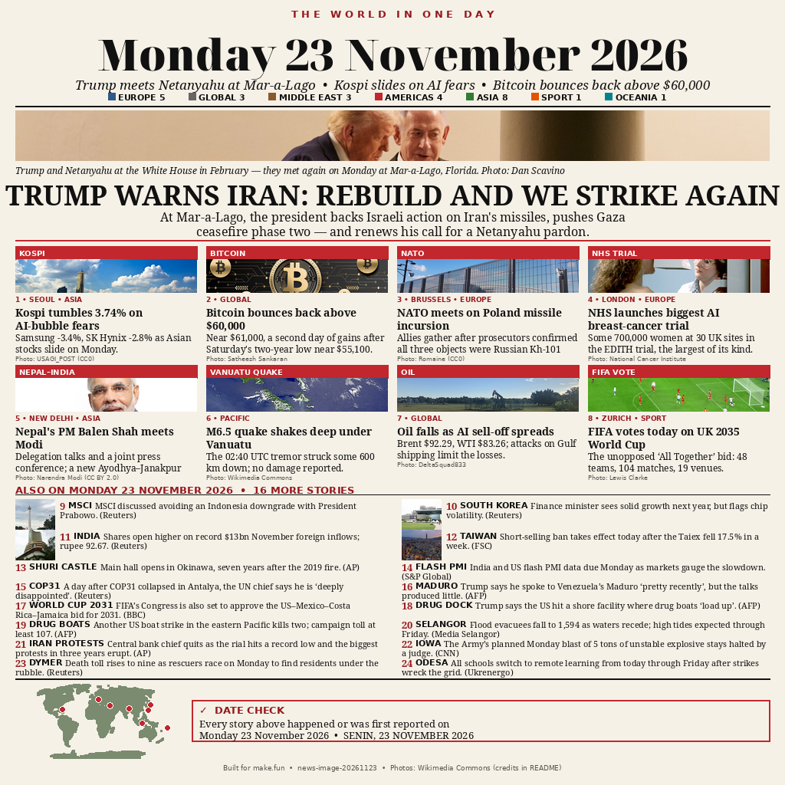

# Monday 23 November 2026 — The World in One Day (Newspaper Front Page)

Entry for the make.fun competition
[news-image-20261123](https://make.fun/bounty/news-image-20261123):
"Sum up 23 November's world news in one image".

Referral code: `5t0n7vxw`

## The image

A newspaper front page in the style of the 22 November entry (provisional
rate 0.981): cream paper, black serif type, red label bars, and the date —
"Monday 23 November 2026" — as the huge masthead headline, with an italic
deck naming the three top stories. Below it, a banner photo of Trump and
Netanyahu with the cover headline, then 8 feature tiles (4×2 grid, stories
1–8) — each with a red label bar, a photo, a location line, a bold headline,
a 1–2 line description and a photo credit — followed by an "ALSO ON"
section (stories 9–24) in two columns, each entry a number, a bold keyword,
one descriptive sentence and a source. A red-bordered DATE CHECK box and a
small sage-green world map in the bottom-left corner close the page. Bright,
attention-grabbing palette; legible at ~300px.

Every story below happened or was first reported on Monday 23 November
2026 (any time zone), verified against wire reporting. The cover story is
the Trump–Netanyahu meeting at Mar-a-Lago: Trump warns Iran of further US
strikes if it rebuilds its nuclear programme, backs Israeli action on
missile rebuilding, pushes Gaza ceasefire phase two, and renews his call
for a Netanyahu pardon. Bitcoin is framed as a rebound (about $61,000 on
Monday, a second day of gains after Saturday's two-year low near $55,100),
not a new low. The FIFA Congress vote is presented as happening today —
the result was not confirmed when this was built. COP31's collapse was
Sunday 22 November, so it appears only as Monday aftermath (the UN chief's
reaction), never as a Monday event. The Poland missile incursion was
Friday 20 November and prosecutors confirmed the objects on Sunday; the
Monday event is the NATO Council meeting in Brussels.

Stories deliberately NOT used (they are not 23 November news): the COP31
collapse itself (22 Nov), the Democrats' House majority (22 Nov), the
"Chapo Isidro" capture (20–21 Nov), Paolo Bulgari's death (21 Nov), the
"killer robots" agreement (21 Nov), the Lisbon cost-of-living protest
(21 Nov), the Nigeria funeral-boat sinking (20 Nov, toll updated 22 Nov),
the FBI NCIC hack (first reported 20 Nov), the Iowa lead-azide court
pause (ordered 20 Nov — only the planned Monday blast is noted), the
Myanmar–ASEAN statement (21 Nov), the US intelligence chief's "my friend"
remarks (22 Nov), the Syria mosque bombing (December 2025), the bomb
cyclone, the New Jersey helicopter crash, the Anthony Joshua crash and
Brigitte Bardot's death (all December 2025, recycled by feeds).

## Stories

Cover: Trump–Netanyahu meet at Mar-a-Lago (AP/AFP).
1. Kospi tumbles 3.74% on AI-bubble fears (Aju Press/CNBC TV18).
2. Bitcoin bounces back above $60,000 (Finnhub/CoinMarketCap).
3. NATO meets on the Poland missile incursion (Reuters).
4. NHS launches the biggest AI breast-cancer trial (Sky News).
5. Nepal's PM Balen Shah meets Modi in Delhi (IANS).
6. M6.5 quake shakes deep under Vanuatu (USGS via Xinhua).
7. Oil falls as the AI sell-off spreads (Reuters).
8. FIFA votes today on the UK as 2035 Women's World Cup host (BBC Sport).
9. MSCI discussed avoiding an Indonesia downgrade with Prabowo (Reuters).
10. South Korea's finance minister sees solid growth, flags chip volatility (Reuters).
11. Indian shares open higher; rupee 92.67 (Reuters).
12. Taiwan's short-selling ban takes effect (FSC).
13. Shuri Castle main hall opens in Okinawa (AP).
14. India and US flash PMI data due Monday (S&P Global).
15. COP31 aftermath: UN chief "deeply disappointed" (Reuters).
16. Trump says he spoke to Venezuela's Maduro "pretty recently" (AFP).
17. FIFA Congress also set to approve the 2031 World Cup bid (BBC).
18. Trump says the US hit a shore drug-loading dock (AFP).
19. Another US boat strike in the eastern Pacific kills two (AFP).
20. Selangor flood evacuees fall to 1,594 (Media Selangor).
21. Iran protests: central bank chief quits as the rial hits a record low (AP).
22. Iowa: the Army's planned Monday blast stays halted by a judge (CNN).
23. Dymer: death toll rises to nine (Reuters).
24. Odesa: all schools switch to remote learning from today (Ukrenergo).

## Photos (Wikimedia Commons)

- Banner: "Donald Trump and Benjamin Netanyahu at White House 2025 (2).jpg" — Public domain — Dan Scavino (White House).
- Kospi: "Han River Seoul skyline Pixabay 1214950.jpg" — CC0 — USAGI_POST.
- Bitcoin: "Bitcoin BTC golden coin with the symbol.jpg" — CC BY-SA 2.0 — Satheesh Sankaran.
- NATO: "Brussels-NATO headquarters.jpg" — CC0 — Romaine.
- NHS: "Mammogram.jpg" — Public domain — National Cancer Institute.
- Nepal–India: "Narendra Damodardas Modi.jpg" — CC BY 2.0 — Narendra Modi.
- Vanuatu: "Satellite image of Vanuatu in October 1998.jpg" — Public domain.
- Oil: "Brunei Pumpjack-1.jpg" — CC BY-SA 4.0 — DeltaSquad833.
- FIFA: "London, Wembley - Wembley Stadium - geograph.org.uk - 2112517.jpg" — CC BY-SA 2.0 — Lewis Clarke.
- World map: "BlankMap-World.png" — Public domain — Vardion.

## How it is built

`render.py` (Pillow, local only) draws the front page from the photos in
`photos/` and writes `entry.png` (1024×1024). `main.py` (standard library
only) copies `entry.png` to `$MAKEFUN_OUTPUT_DIR/entry.png`, verifying the
PNG header, the 1024×1024 size and the 1 MiB limit first.
